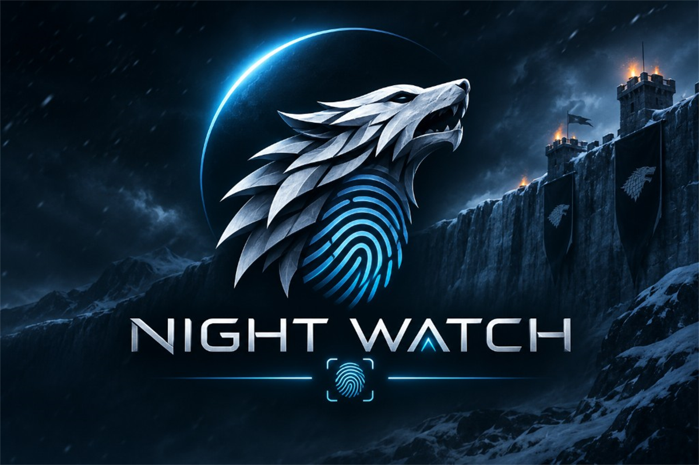

# Night Watch

<p align="center">
  
</p>

**One product.** Self-hosted browser identification + server risk stack.  
No Fingerprint.com / fpjs.io runtime dependency. No ?simple vs Pro? split. No fake calibrated ML claims.

Brand kit: [`branding/`](./branding/) (hero, icons, palette).

| | |
|---|---|
| **Product** | **Night Watch** |
| **Browser** | `@night-watch/core`, `@night-watch/browser-sdk` ? 41-source default entropy profile |
| **Frameworks** | `@night-watch/vanilla` · `react` · `vue` · `angular` · `preact` · `blazor` |
| **Server** | Night Watch API (`identity-v4`) — identify, smart signals, decisions, management |
| **License** | [MIT](./LICENSE) · attribution in [NOTICE](./NOTICE) |
| **Status** | **1.0.0** |

> Night Watch is **not** an official Fingerprint product. Behavioral baseline for the open-source collectors was FingerprintJS OSS **v5.3.0**; algorithms were adapted under MIT. Vendor SaaS hosts are **forbidden** at runtime.

---

## Why this exists

Teams that must keep fingerprinting **first-party** — air-gapped, on-prem, or otherwise unable to call foreign fingerprint SaaS — get a single stack:

1. Browser collection on your origin  
2. Server identity, risk signals, and decisions — with offline reputation feeds and no vendor telemetry

Honest boundary: Night Watch is a self-hosted identification/risk platform, **not** a clone of any commercial global SaaS population network.

---

## Architecture (high level)

```text
+--------------------------+   POST /v1/identify   +--------------------------+
¦  @night-watch/browser-sdk¦ -------------------? ¦  Night Watch API     ¦
¦  playground / site       ¦   + environmentProbes¦  identity-v4             ¦
+--------------------------+                      ¦  smart signals · score   ¦
                                                  ¦  decisions · webhooks    ¦
                                                  +--------------------------+
                                                               ¦
                                                  SQLite (dev) / Postgres
                                                  optional Redis · Helm
```

| Layer | Path | Role |
|---|---|---|
| Core + Browser SDK | `packages/core`, `packages/browser-sdk` | Collect & hash components ? `visitorId` |
| Adapters / contracts | `packages/pro-*` | Typed contracts, browser adapter, server SDK, web agent |
| Playground | `apps/playground` | Local Vite demo (`127.0.0.1:4173`) |
| Admin console | `apps/admin-console` | Management UI |
| API | `server/src/NightWatch.Api` | Identify, risk, decisions, privacy, lab |
| Deploy | `server/deploy`, `server/docker-compose.yml` | On-prem / Compose / Helm |

---

## Features

### Browser SDK (`@night-watch/*`)
- **41 entropy sources** (default manifest); payment API-state (`applePay`) excluded by design  
- MurmurHash3 x64-128 visitor hash  
- ESM / CJS / IIFE / UMD bundles — **self-hostable**, no CDN required  
- Global IIFE name: `NightWatch`  
- Telemetry **off** by default (`monitoring` is a no-op)  
- SSR-safe import; honest `unsupported` / `error` semantics  

### Night Watch API (`identity-v4`)
- **Identify**: exact alias rematch, continuity token rematch, soft-link insights **without** silent visitor merge  
- **Confidence**: `unavailable` · `heuristic` · `holdout_backed` — never invents production-calibrated ML  
- **Smart signals** (web): bot / automation / tamper / VM / VPN·proxy (offline ASN feed) / rare-device (tenant-local population) / proximity (consent-gated) / MITM (edge TLS headers) / velocity  
- **Decisions**: weighted suspect score + challenge flow  
- **Network feed**: signed offline ASN/IP reputation bundle — no live foreign SaaS lookup  
- **Management**: API keys, rules, webhooks, privacy export/erase, graph edges, console auth (+ optional MFA)  
- **Sealed envelopes** for customer-backend verification  

### Explicitly out of scope (today)
- Commercial global SaaS population / live crawl networks  
- Native mobile SDK  
- Claiming **production-calibrated ML** without your own labeled fraud feedback in production  

Details: [`docs/ACCURACY_AND_LIMITATIONS.md`](./docs/ACCURACY_AND_LIMITATIONS.md) · [`docs/proplus-progress/STEP_135.md`](./docs/proplus-progress/STEP_135.md)

---

## Quick start

### Requirements
- **Node.js** = 20 · **pnpm** 12  
- **.NET SDK** 10.x (see `server/global.json`) for the API  

### 1) Browser SDK

```bash
pnpm install --frozen-lockfile
pnpm build
pnpm playground          # http://127.0.0.1:4173
```

```ts
import { load } from '@night-watch/browser-sdk'

const agent = await load({ monitoring: false })
const result = await agent.get()
console.log(result.visitorId, result.confidence.score)
```

Self-hosted IIFE (copy `packages/browser-sdk/dist/fp.min.js` to your origin):

```html
<script src="/vendor/night-watch/fp.min.js"></script>
<script>
  NightWatch.load({ monitoring: false }).then((agent) => agent.get()).then((r) => {
    console.log(r.visitorId)
  })
</script>
```

Framework bindings (same `visitorId` as the browser SDK):

| Package | Use |
|---|---|
| `@night-watch/vanilla` | `identify()` / `createNightWatchClient()` |
| `@night-watch/react` | `useVisitorData()` |
| `@night-watch/vue` | `useVisitorData()` composable |
| `@night-watch/angular` | `NightWatchService` / `provideNightWatch()` |
| `@night-watch/preact` | `useVisitorData()` |
| `@night-watch/blazor` | JS interop + `NightWatch.Blazor` C# helper |

```ts
import { identify } from '@night-watch/vanilla'
import { useVisitorData } from '@night-watch/react' // or vue / preact

const { visitorId } = await identify()
```

### 2) Night Watch API (local)

```bash
# from repo root
dotnet build server/NightWatch.sln -c Release
$env:ASPNETCORE_URLS = "http://127.0.0.1:5080"   # PowerShell
dotnet exec server/src/NightWatch.Api/bin/Release/net10.0/NightWatch.Api.dll
```

Health:

```bash
curl http://127.0.0.1:5080/health/live
```

Identify (minimal):

```bash
curl -s http://127.0.0.1:5080/v1/identify \
  -H "Content-Type: application/json" \
  -H "Idempotency-Key: demo-00000001" \
  -d '{
    "schemaVersion": "night-watch-identify-v1",
    "productCode": "night-watch",
    "purpose": "fraud_prevention",
    "consentStatus": "granted",
    "collectedAt": "2026-01-01T00:00:00Z",
    "idempotencyKey": "demo-00000001",
    "tenantId": "ten_demo",
    "projectId": "prj_demo",
    "region": "eu-west",
    "legacyBrowser": {
      "visitorId": "aaaaaaaaaaaaaaaaaaaaaaaaaaaaaaaa",
      "sourceManifestRevision": "default-v1",
      "componentKeys": ["canvas", "fonts", "audio"]
    }
  }'
```

Docker Compose (Postgres + Redis + API): see [`server/docker-compose.yml`](./server/docker-compose.yml) and [`server/deploy/`](./server/deploy/).

---

## Core HTTP surfaces (Night Watch)

| Method | Path | Purpose |
|---|---|---|
| `POST` | `/v1/identify` | Server-authoritative visitor match + optional smart signals |
| `POST` | `/v1/decisions/evaluate` | Risk decision from observed probes / score |
| `POST` | `/v1/observations` | Observation ingest |
| `POST` | `/v1/sealed/unseal` | Verify sealed identify envelope |
| `POST` | `/v1/lab/network/lookup` | Offline ASN/IP reputation lookup |
| `POST` | `/v1/lab/calibration/run` | Lab feedback / holdout metrics (not production ML claim) |
| `POST` | `/v1/management/*` | Keys, rules, webhooks, privacy, score explain (console auth) |

Full SDK API: [`docs/API.md`](./docs/API.md).

---

## Tests & verification

```bash
# JS unit + typecheck + build
pnpm lint && pnpm typecheck && pnpm test && pnpm build

# Playwright (browser matrix)
pnpm test:e2e

# Night Watch API (focused identity suites)
dotnet test server/NightWatch.sln -c Release --filter "FullyQualifiedName~GapClosureV4Tests|FullyQualifiedName~IdentityStabilityTests|FullyQualifiedName~BeatProWaveTests"

# Live 500-case harness against a running API on :5080
powershell -NoProfile -ExecutionPolicy Bypass -File scripts/run-500-cases.ps1 -Count 500
```

CI: [`.github/workflows/ci.yml`](./.github/workflows/ci.yml).

---

## Repository map

```text
apps/                 playground, admin-console
packages/             @night-watch/*
server/               ASP.NET Core Night Watch API, persistence, deploy
contracts/            shared schemas
docs/                 product + architecture docs
examples/             typed SDK samples
scripts/              CI guards, demo, 500-case harness
```

---

## Documentation

| Doc | Contents |
|---|---|
| [`docs/API.md`](./docs/API.md) | Browser SDK public API |
| [`docs/ACCURACY_AND_LIMITATIONS.md`](./docs/ACCURACY_AND_LIMITATIONS.md) | What we do **not** claim |
| [`docs/PRIVACY.md`](./docs/PRIVACY.md) | Consent & retention guidance |
| [`docs/BUILD.md`](./docs/BUILD.md) | Bundles, checksums, offline supply chain |
| [`docs/MIGRATION.md`](./docs/MIGRATION.md) | From FingerprintJS OSS |
| [`docs/proplus-progress/`](./docs/proplus-progress/) | Delivery steps |
| [`server/deploy/`](./server/deploy/) | On-prem / air-gap deploy notes |
| [`SECURITY.md`](./SECURITY.md) | Vulnerability reporting |
| [`CHANGELOG.md`](./CHANGELOG.md) | Release notes |

---

## Configuration notes (Night Watch)

Dev defaults live in `server/src/NightWatch.Api/appsettings.json`:

- Empty Postgres ? **SQLite** file `night-watch-dev.db` (local durable aliases / vectors)  
- `NightWatch:IpDatasets:AllowOutboundLookup` = `false` (offline feed only)  
- `ForbidVendorHosts` = `true`  
- Product code: `night-watch` · identity algorithm: `identity-v4`  

For tests that must not collide with a live DB, set `NIGHT_WATCH_TEST_SQLITE` to a unique path (the API test assembly does this automatically).

---

## Security & privacy

- Do **not** use client `visitorId` alone for authentication or high-value authorization.  
- Prefer server identify + sealed envelope verification on your backend.  
- Treat labels / feedback as sensitive; production calibration requires **your** fraud labels — the lab calibration endpoint is for development metrics only.  
- Report vulnerabilities per [`SECURITY.md`](./SECURITY.md).

---

## Trademark & attribution

- Product: **Night Watch**  
- npm scope: `@night-watch/*`  
- Browser IIFE global: `NightWatch`  
- See [`NOTICE`](./NOTICE) for MIT attribution to FingerprintJS OSS where applicable.  
- Forbidden runtime hosts include `fingerprint.com`, `fpjs.io`, `openfpcdn`, `fingerprintjs`.

---

## License

[MIT](./LICENSE) © 2026 Night Watch contributors
