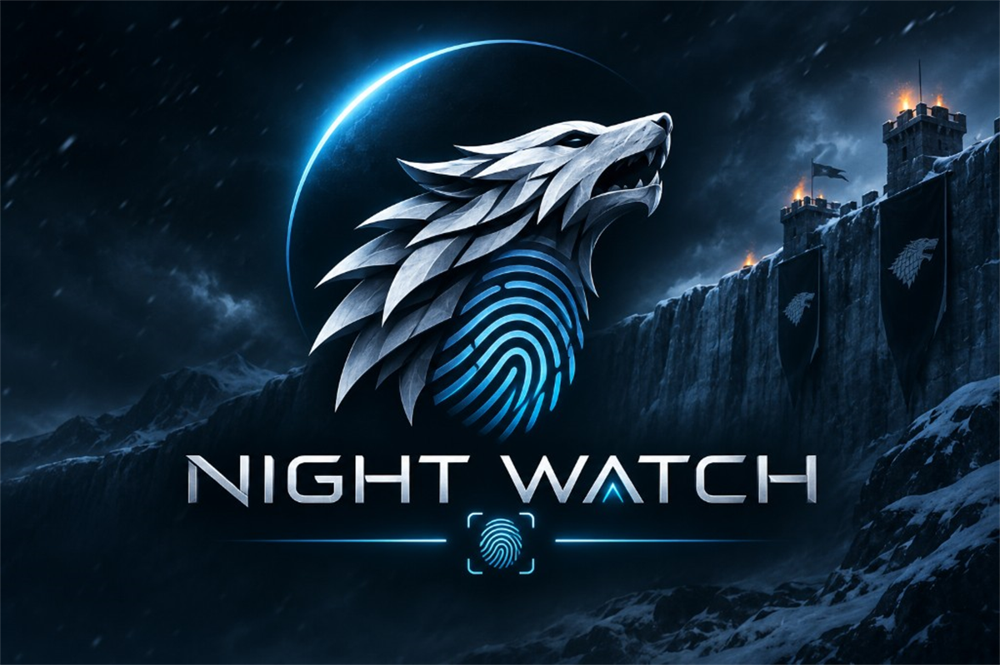

# Migration guide

<p align="center">
  
</p>

## From FingerprintJS OSS `@fingerprintjs/fingerprintjs@5.3.0`

| Topic | Upstream OSS | This SDK (`@night-watch`) |
|---|---|---|
| Package | `@fingerprintjs/fingerprintjs` | `@night-watch/browser-sdk` (+ `@night-watch/core`) |
| Global | `FingerprintJS` | `NightWatch` |
| Sources | 42 builtins | **41** — `applePay` excluded |
| `monitoring` | May beacon | Default **false**; always no-op here |
| Raw `visitorId` | Includes all 42 | **Not** expected to equal upstream raw ID |
| Filtered hash | Omit `applePay` then hash | Can match when components match (see step 58 report) |

### Code mapping

```ts
// Before
import FingerprintJS from '@fingerprintjs/fingerprintjs'
const fp = await FingerprintJS.load()
const r = await fp.get()

// After
import { load } from '@night-watch/browser-sdk'
const fp = await load({ monitoring: false })
const r = await fp.get()
```

IIFE:

```html
<!-- Before: FingerprintJS.load() -->
<!-- After: -->
<script src="/vendor/night-watch/fp.min.js"></script>
<script>
  NightWatch.load({ monitoring: false }).then((a) => a.get())
</script>
```

### Parity expectations

1. Compare the **41** overlapping component values (not raw visitorId).
2. For hash checks in tests, omit `applePay` from upstream components first.
3. Document any intentional collector deviations in `reference/parity_decisions.md`.

## Algorithm / ID-breaking changes

`SOURCE_MANIFEST_REVISION` (`default-v1`) must change when you:

- add/remove/reorder default sources,
- change canonical serialization or hash algorithm,
- change default exclusion set.

Announce breaks in release notes. Do **not** claim bit-for-bit continuity across
manifest revisions.

## From an older `@ibf` / pre–Night Watch pre-release

1. Diff `ENABLED_SOURCES` and `ALGORITHM_SCHEMA`.
2. Re-run consented differential / stability reports if you store visitorIds.
3. Recompute SRI / checksums for self-hosted bundles.
