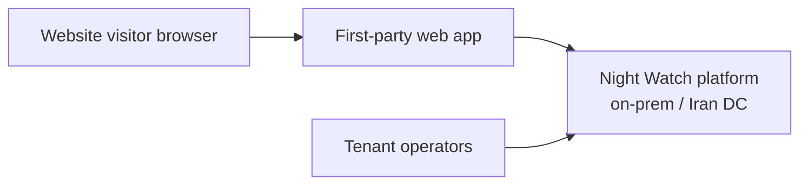
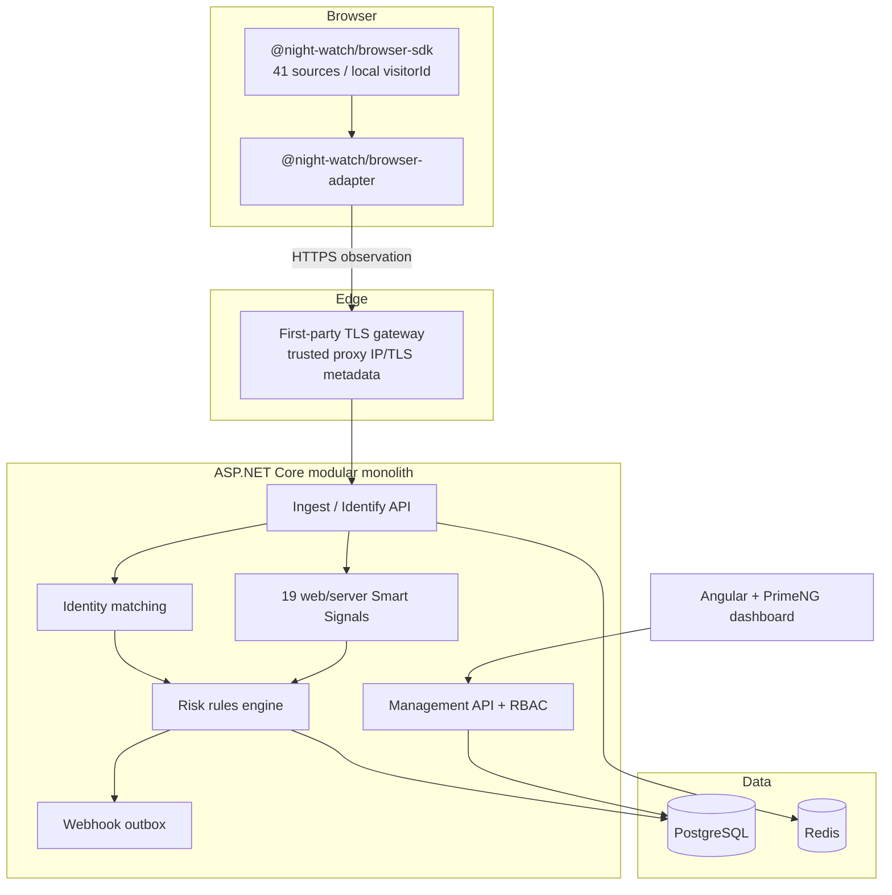
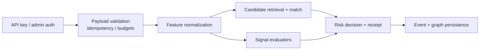

# Night Watch — C4 views, trust boundaries, and data flows

**Product:** Night Watch (`night-watch`)  
**Scope:** Web JS/TS + ASP.NET Core + PostgreSQL + Redis + Angular admin  
**Non-scope:** Native mobile SDKs, Apple Pay, vendor SaaS call-home

## C4 — Context

External systems: none required at runtime. Optional offline IP/intelligence **bundles** are operator-imported, not live SaaS.

## C4 — Containers

## C4 — Components (API host)

## Trust boundaries

| Zone | Trust level | Rules |
|---|---|---|
| Browser JS | **Untrusted** | Spoofable. Never authoritative for risk/auth. |
| Edge gateway | **Conditional** | Only after validated trusted-proxy config; raw `X-Forwarded-For` from clients is untrusted. |
| ASP.NET Core | **Trusted compute** | Assigns `eventId`, server `visitorId`, signs receipts. |
| PostgreSQL | **System of record** | Tenant RLS / `tenant_id` on all rows. |
| Redis | **Ephemeral** | Cache/velocity only; rebuildable. |
| Operators | **Privileged** | RBAC + audit log; break-glass reviewed. |
| Offline datasets | **Provider-qualified** | License/hash/expiry; stale → `provider_unavailable` / `stale`. |

## Sync vs async and latency budgets

| Path | Mode | Budget (p95 target, lab) | Failure fallback |
|---|---|---:|---|
| Legacy `load()/get()` | Sync local | unchanged SDK | Local-only; no network |
| `POST /v1/observations` | Sync accept | ≤ 100 ms accept + enqueue | 429/413; no silent drop without idempotency key policy |
| `POST /v1/identify` | Sync decision path | ≤ 250 ms without heavy intel | Return `insufficient_evidence` / `unknown` signals; never invent certainty |
| Signal enrichment | Async optional | ≤ 2 s soft | Persist partial; mark `unavailable` |
| Webhooks | Async outbox | best-effort + retry | Signed retries; dead-letter after policy |
| Management UI reads | Sync | ≤ 500 ms list/detail | Empty with explicit error problem+json |

## Versioning, region, retention

- **Source set:** browser `default-v1` immutable without adapter ADR.
- **Server identity:** `night-watch-identity-v0` (bumped on matching changes).
- **Processing:** `night-watch-processing-v0`.
- **Region:** default local-only / Iran or air-gapped DC; no foreign cloud dependency.
- **Retention:** tenant-configurable; erasure cascades visitors, aliases, graph, analytics projections.
- **Apple Pay:** excluded everywhere.

## Failure modes (must be designed-in)

1. Browser offline → local visitorId still works; ProPlus identify returns network `unavailable`.
2. Redis down → degrade velocity signals to `unavailable`; core identify still persists to Postgres.
3. Postgres primary fail → API 503; no dual-write to foreign SaaS.
4. Poison observation → validation 4xx; never crash worker silently without audit.
5. Stale intel bundle → `stale` / `provider_unavailable`, not false negatives presented as clean.
6. Native-only signal request → `not_applicable` + `requires_native_sdk`.
